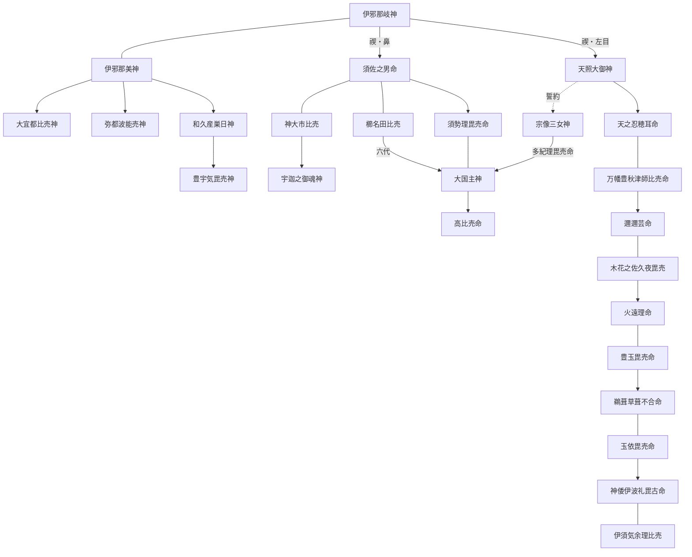

# 古事記の女神 目次

『古事記』（712年〈皇紀1372年・和銅5年〉成立）に登場する女神を、一柱につき一ファイルで解説する資料集の目次です。各ファイルは「基本情報」「概要」「概説」「エピソード」「『日本書紀』等との比較」「祭祀」「参考資料」で構成しています。

- 収録数：**68柱**（上巻 65柱／中巻 3柱）
- 配列：おおむね古事記本文での初出順

---

## 凡例

1. **収録基準**
   - 古事記本文に登場し、次のいずれかに当たる神を収録した。
     - 「妹（いも）」「女（むすめ）」「比売・毘売・売・女」など、女性であることが本文または神名から明らかな神
     - 系譜で男神が「娶りて」子を生んだ相手として記される神（＝妻神）
     - 性別の明記はないが、後世の信仰・通説で女神とされる神（[宇迦之御魂神](31_宇迦之御魂神.md)など。該当ファイルに注記）
   - 中巻・下巻の人代の女性（皇后・皇女など）は原則として除外し、本文で「神」「神の御子」と明記される女性のみ収録した（[伊須気余理比売](66_伊須気余理比売.md)・[阿加流比売神](67_阿加流比売神.md)・[伊豆志袁登売神](68_伊豆志袁登売神.md)）。
2. **表記**：神名は古事記本文の表記を優先し、『日本書紀』等の表記は「別名・異表記」に示した。歴史用語は漢字表記を優先した。
3. **読み**：現代仮名遣いで示した。注釈書により読みが異なる場合は併記した。
4. **年の表記**：「西暦年（皇紀〇年・和暦〇年）」の形式とした。和暦制定以前は天皇の治世年（『日本書紀』紀年）を示し、その旨を注記した。
5. **本文引用**：古事記・日本書紀の引用は訓読（書き下し）で示した。訓みは注釈書によって異なるため、厳密な引用には下記の校訂本文を参照されたい。歌謡の現代語訳は大意である。
6. **不確実な情報**：名義（神名の語源）解釈、比定地、現行の祭神構成など、確証のない情報には「※諸説あり」「※推定」「※要確認」「※未確認」等を付した。
7. **専門用語**：主要な学術用語は「英語（日本語訳）」または「日本語（英語）」の形で示した。

---

## 一覧

### 第一部　神世七代

| No. | 神名 | 読み | 主な場面・神格 | 区分 |
|---|---|---|---|---|
| 01 | [須比智邇神](01_須比智邇神.md) | すひぢにのかみ | 神世七代 第三代。泥・砂の神 | 系譜 |
| 02 | [活杙神](02_活杙神.md) | いくぐいのかみ | 神世七代 第四代。萌芽・杭の神 | 系譜 |
| 03 | [大斗乃弁神](03_大斗乃弁神.md) | おおとのべのかみ | 神世七代 第五代。戸・住居の神 | 系譜 |
| 04 | [阿夜訶志古泥神](04_阿夜訶志古泥神.md) | あやかしこねのかみ | 神世七代 第六代。後世、第六天と習合 | 系譜 |
| 05 | [伊邪那美神](05_伊邪那美神.md) | いざなみのかみ | 国生み・神生み・黄泉国。生と死の母神 | **主要** |

### 第二部　国生み（島の女神）

| No. | 神名 | 読み | 主な場面・神格 | 区分 |
|---|---|---|---|---|
| 06 | [愛比売](06_愛比売.md) | えひめ | 伊予国の名。愛媛県名の由来 | 系譜 |
| 07 | [大宜都比売神](07_大宜都比売神.md) | おおげつひめのかみ | 粟国の名／食物神。殺されて五穀・蚕を生む | **主要** |
| 08 | [天之狭手依比売](08_天之狭手依比売.md) | あめのさでよりひめ | 津島（対馬）の名 | 系譜 |
| 09 | [大野手比売](09_大野手比売.md) | おおのでひめ | 小豆島の名 | 系譜 |

### 第三部　神生み・伊邪那美神の死・禊祓

| No. | 神名 | 読み | 主な場面・神格 | 区分 |
|---|---|---|---|---|
| 10 | [石巣比売神](10_石巣比売神.md) | いわすひめのかみ | 家屋生成の神々。石と砂 | 系譜 |
| 11 | [速秋津比売神](11_速秋津比売神.md) | はやあきつひめのかみ | 水戸（河口）の神。大祓詞の速開都比売 | 準主要 |
| 12 | [沫那美神](12_沫那美神.md) | あわなみのかみ | 水の泡の神（性別は名義から推定） | 系譜 |
| 13 | [頬那美神](13_頬那美神.md) | つらなみのかみ | 水面の神（性別は名義から推定） | 系譜 |
| 14 | [鹿屋野比売神](14_鹿屋野比売神.md) | かやのひめのかみ | 野の神（野椎神）。大山津見神と八神を生む | 準主要 |
| 15 | [大戸惑女神](15_大戸惑女神.md) | おおとまといめのかみ | 山中の谷・峠で迷わせる神 | 系譜 |
| 16 | [金山毘売神](16_金山毘売神.md) | かなやまびめのかみ | 伊邪那美の嘔吐物から。鉱山・金属の神 | 準主要 |
| 17 | [波邇夜須毘売神](17_波邇夜須毘売神.md) | はにやすびめのかみ | 伊邪那美の屎から。粘土・土の神 | 準主要 |
| 18 | [弥都波能売神](18_弥都波能売神.md) | みつはのめのかみ | 伊邪那美の尿から。水の神 | 準主要 |
| 19 | [豊宇気毘売神](19_豊宇気毘売神.md) | とようけびめのかみ | 和久産巣日神の子。伊勢外宮の豊受大御神 | **主要** |
| 20 | [泣沢女神](20_泣沢女神.md) | なきさわめのかみ | 伊邪那岐の涙から。哭女・泉の神 | 準主要 |
| 21 | [伊豆能売](21_伊豆能売.md) | いづのめ | 禊祓で禍を直す神 | 系譜 |

### 第四部　高天原（三貴子・誓約・天石屋戸）

| No. | 神名 | 読み | 主な場面・神格 | 区分 |
|---|---|---|---|---|
| 22 | [天照大御神](22_天照大御神.md) | あまてらすおおみかみ | 太陽神・皇祖神。誓約・天石屋戸・天孫降臨 | **主要** |
| 23 | [多紀理毘売命](23_多紀理毘売命.md) | たきりびめのみこと | 宗像三女神（奥津宮）。大国主神の妻 | **主要** |
| 24 | [市寸島比売命](24_市寸島比売命.md) | いちきしまひめのみこと | 宗像三女神（中津宮）。厳島・弁才天 | **主要** |
| 25 | [多岐都比売命](25_多岐都比売命.md) | たきつひめのみこと | 宗像三女神（辺津宮） | 準主要 |
| 26 | [天宇受売命](26_天宇受売命.md) | あめのうずめのみこと | 天石屋戸の舞。猿田毘古神と対峙。猿女君の祖 | **主要** |
| 27 | [伊斯許理度売命](27_伊斯許理度売命.md) | いしこりどめのみこと | 天石屋戸の鏡を作る。作鏡連の祖 | 準主要 |

### 第五部　出雲（須佐之男命とその系譜）

| No. | 神名 | 読み | 主な場面・神格 | 区分 |
|---|---|---|---|---|
| 28 | [手名椎](28_手名椎.md) | てなづち | 櫛名田比売の母。八俣遠呂智退治 | 準主要 |
| 29 | [櫛名田比売](29_櫛名田比売.md) | くしなだひめ | 八俣遠呂智退治。須佐之男命の妻。「八雲立つ」 | **主要** |
| 30 | [神大市比売](30_神大市比売.md) | かむおおいちひめ | 須佐之男命の妻。大年神・宇迦之御魂神の母 | 系譜 |
| 31 | [宇迦之御魂神](31_宇迦之御魂神.md) | うかのみたまのかみ | 稲の霊。稲荷神（性別は後世の解釈） | **主要** |
| 32 | [木花知流比売](32_木花知流比売.md) | このはなちるひめ | 八島士奴美神の妻 | 系譜 |
| 33 | [日河比売](33_日河比売.md) | ひかわひめ | 布波能母遅久奴須奴神の妻。淤迦美神の女 | 系譜 |
| 34 | [天之都度閇知泥神](34_天之都度閇知泥神.md) | あめのつどへちねのかみ | 深淵之水夜礼花神の妻。淤美豆奴神の母 | 系譜 |
| 35 | [布帝耳神](35_布帝耳神.md) | ふてみみのかみ | 淤美豆奴神の妻。大国主神の祖母 | 系譜 |
| 36 | [刺国若比売](36_刺国若比売.md) | さしくにわかひめ | 大国主神の母。死んだ子を二度蘇らせる | **主要** |

### 第六部　大国主神（八十神の迫害・根の堅州国・妻問い・系譜）

| No. | 神名 | 読み | 主な場面・神格 | 区分 |
|---|---|---|---|---|
| 37 | [八上比売](37_八上比売.md) | やかみひめ | 稲羽の素菟。大穴牟遅神を選ぶ | **主要** |
| 38 | [𧏛貝比売](38_蚶貝比売.md) | きさがいひめ | 赤貝の女神。大穴牟遅神を蘇生 | 準主要 |
| 39 | [蛤貝比売](39_蛤貝比売.md) | うむぎひめ | 蛤の女神。大穴牟遅神を蘇生 | 準主要 |
| 40 | [須勢理毘売命](40_須勢理毘売命.md) | すせりびめのみこと | 根の堅州国の試練。大国主神の嫡妻。神語 | **主要** |
| 41 | [沼河比売](41_沼河比売.md) | ぬなかわひめ | 高志国の女神。八千矛神の妻問い。翡翠 | **主要** |
| 42 | [神屋楯比売命](42_神屋楯比売命.md) | かむやたてひめのみこと | 大国主神の妻。事代主神の母 | 系譜 |
| 43 | [鳥耳神](43_鳥耳神.md) | とりみみのかみ | 大国主神の妻。以下「十七世の神」の系譜 | 系譜 |
| 44 | [日名照額田毘道男伊許知邇神](44_日名照額田毘道男伊許知邇神.md) | ひなてりぬかたびちおいこちにのかみ | 鳥鳴海神の妻 | 系譜 |
| 45 | [葦那陀迦神](45_葦那陀迦神.md) | あしなだかのかみ | 国忍富神の妻（八河江比売） | 系譜 |
| 46 | [前玉比売](46_前玉比売.md) | さきたまひめ | 速甕之多気佐波夜遅奴美神の妻 | 系譜 |
| 47 | [比那良志毘売](47_比那良志毘売.md) | ひならしびめ | 甕主日子神の妻。淤加美神の女 | 系譜 |
| 48 | [活玉前玉比売神](48_活玉前玉比売神.md) | いくたまさきたまひめのかみ | 多比理岐志麻流美神の妻 | 系譜 |
| 49 | [青沼馬沼押比売](49_青沼馬沼押比売.md) | あおぬまぬおしひめ | 美呂浪神の妻 | 系譜 |
| 50 | [若尽女神](50_若尽女神.md) | わかつくしめのかみ | 布忍富鳥鳴海神の妻 | 系譜 |
| 51 | [遠津待根神](51_遠津待根神.md) | とおつまちねのかみ | 天日腹大科度美神の妻。系譜の最後 | 系譜 |

### 第七部　大年神の系譜

| No. | 神名 | 読み | 主な場面・神格 | 区分 |
|---|---|---|---|---|
| 52 | [伊怒比売](52_伊怒比売.md) | いのひめ | 大年神の妻。韓神・曾富理神などの母 | 系譜 |
| 53 | [香用比売](53_香用比売.md) | かよひめ | 大年神の妻。御年神の母 | 系譜 |
| 54 | [天知迦流美豆比売](54_天知迦流美豆比売.md) | あめちかるみずひめ | 大年神の妻。竈神・大山咋神などの母 | 系譜 |
| 55 | [奥津比売命](55_奥津比売命.md) | おきつひめのみこと | 竈神（大戸比売神）。「諸人の以ち拝く竈神」 | 準主要 |
| 56 | [若沙那売神](56_若沙那売神.md) | わかさなめのかみ | 田植え（早乙女）の女神 | 系譜 |
| 57 | [夏之売神](57_夏之売神.md) | なつのめのかみ | 夏の日の神（夏高津日神） | 系譜 |
| 58 | [秋毘売神](58_秋毘売神.md) | あきびめのかみ | 秋の稔りの女神 | 系譜 |

### 第八部　葦原中国平定・天孫降臨

| No. | 神名 | 読み | 主な場面・神格 | 区分 |
|---|---|---|---|---|
| 59 | [高比売命](59_高比売命.md) | たかひめのみこと | 下照比売。天若日子の妻。夷振の歌 | **主要** |
| 60 | [天佐具売](60_天佐具売.md) | あめのさぐめ | 雉の射殺を勧める。天邪鬼の起源とされる | 準主要 |
| 61 | [万幡豊秋津師比売命](61_万幡豊秋津師比売命.md) | よろずはたとよあきつしひめのみこと | 高木神の女。天孫邇邇芸命の母 | 準主要 |
| 62 | [木花之佐久夜毘売](62_木花之佐久夜毘売.md) | このはなのさくやびめ | 邇邇芸命の妻。火中出産。浅間大神 | **主要** |
| 63 | [石長比売](63_石長比売.md) | いわながひめ | 邇邇芸命に返される。天皇の寿命の起源 | **主要** |

### 第九部　日向（海佐知山佐知）

| No. | 神名 | 読み | 主な場面・神格 | 区分 |
|---|---|---|---|---|
| 64 | [豊玉毘売命](64_豊玉毘売命.md) | とよたまびめのみこと | 海神の女。火遠理命の妻。「見るなの禁」 | **主要** |
| 65 | [玉依毘売命](65_玉依毘売命.md) | たまよりびめのみこと | 豊玉毘売の妹。神武天皇の母 | **主要** |

### 第十部　中巻（人代に登場する女神）

| No. | 神名 | 読み | 主な場面・神格 | 区分 |
|---|---|---|---|---|
| 66 | [伊須気余理比売](66_伊須気余理比売.md) | いすけよりひめ | 大物主神の娘（神の御子）。神武天皇の大后 | **主要** |
| 67 | [阿加流比売神](67_阿加流比売神.md) | あかるひめのかみ | 日光感精の赤玉から化生。天之日矛の妻 | **主要** |
| 68 | [伊豆志袁登売神](68_伊豆志袁登売神.md) | いずしおとめのかみ | 春山之霞壮夫と秋山之下氷壮夫の争い | 準主要 |

**区分の目安**：**主要**＝複数の場面で行為・発話を伴うエピソードを持つ女神／準主要＝特定の場面で役割を持つ、または後世の信仰が大きい女神／系譜＝古事記では系譜記事にのみ現れる女神

---

## 主要女神の系譜関係（略図）

（実線＝親子・婚姻、点線＝誓約による化成。表示の都合上、多くの神を省略している）

---

## 参考：収録しなかった女性・女神

以下は古事記に登場する、または女神として知られるが、本資料の収録基準から外したものである。

| 名 | 理由・備考 |
|---|---|
| 予母都志許売（黄泉醜女） | 伊邪那美神が遣わした黄泉国の鬼女。固有の神格を持つ個体名ではないため除外（→[伊邪那美神](05_伊邪那美神.md)に記述） |
| 天の服織女（はたおりめ） | 須佐之男命の乱暴で死んだ機織女。名がないため除外（→[天照大御神](22_天照大御神.md)に記述） |
| 雉名鳴女（きぎしななきめ） | 天つ神の使者の雉。鳥であるため除外（→[高比売命](59_高比売命.md)・[天佐具売](60_天佐具売.md)に記述） |
| 神産巣日神 | 造化三神の一柱。古事記では独神で性別の記述はないが、「御祖」として大国主神を助けることから母神的性格が指摘される |
| 勢夜陀多良比売 | 大物主神の妻、伊須気余理比売の母。人の娘（三島湟咋の女）であるため除外（→[伊須気余理比売](66_伊須気余理比売.md)に記述） |
| 活玉依毘売 | 中巻崇神記。三輪山伝説で大物主神の子を宿す人の娘 |
| 肥長比売 | 中巻垂仁記。本牟智和気王が一夜を共にし、正体が蛇であったとされる女性 |
| 息長帯比売命（神功皇后）・倭比売命 | 人代の皇族女性 |
| 菊理媛神（くくりひめのかみ） | 『日本書紀』一書のみに登場。古事記には見えない |
| 瀬織津比売・速佐須良比売 | 『延喜式』大祓詞の祓戸神。古事記には見えない（→[速秋津比売神](11_速秋津比売神.md)に記述） |
| 稚日女尊（わかひるめのみこと） | 『日本書紀』のみに登場 |

---

## 主要参考文献

### 一次資料
- 『古事記』（712年〈皇紀1372年・和銅5年〉成立）。最古写本は真福寺本（1371〜1372年〈皇紀2031〜2032年・応安4〜5年〉書写、国宝、大須観音宝生院蔵）
- 『日本書紀』（720年〈皇紀1380年・養老4年〉成立）
- 『出雲国風土記』（733年〈皇紀1393年・天平5年〉成立）、その他諸国風土記・逸文
- 『万葉集』（8世紀後半成立）
- 『止由気宮儀式帳』『皇太神宮儀式帳』（804年〈皇紀1464年・延暦23年〉撰進）
- 『古語拾遺』斎部広成撰（807年〈皇紀1467年・大同2年〉成立）
- 『延喜式』（927年〈皇紀1587年・延長5年〉撰進、967年〈皇紀1627年・康保4年〉施行）神名帳・祝詞
- 『先代旧事本紀』（平安時代初期成立とされる。成立年代・史料的価値には議論がある）

### 校訂本文・注釈書
- 本居宣長『古事記伝』（1798年〈皇紀2458年・寛政10年〉完成）
- 倉野憲司・武田祐吉 校注『古事記 祝詞』（日本古典文学大系1）岩波書店、1958年（皇紀2618年・昭和33年）
- 西郷信綱『古事記注釈』全4巻（のち全8巻）、平凡社、1975〜1989年（皇紀2635〜2649年・昭和50〜平成元年）
- 山口佳紀・神野志隆光 校注・訳『古事記』（新編日本古典文学全集1）小学館、1997年（皇紀2657年・平成9年）
- 坂本太郎ほか 校注『日本書紀』（日本古典文学大系67・68）岩波書店、1965〜1967年（皇紀2625〜2627年・昭和40〜42年）
- 土橋寛『古代歌謡全注釈 古事記編』角川書店、1972年（皇紀2632年・昭和47年）

### 研究書
- 柳田國男『妹の力』創元社、1940年（皇紀2600年・昭和15年）
- 大林太良『日本神話の起源』角川書店、1961年（皇紀2621年・昭和36年）
- 松前健『日本神話の形成』塙書房、1970年（皇紀2630年・昭和45年）
- 吉田敦彦『日本神話の源流』講談社現代新書、1976年（皇紀2636年・昭和51年）

### オンライン資料
- 國學院大學 古事記学センター「古事記ビューア」「神名データベース」（https://kojiki.kokugakuin.ac.jp/）
- 国立国会図書館デジタルコレクション（『古事記伝』等の古典籍画像）

---

## 留意事項

- 本資料は注釈書・研究書の通説に基づいて作成したが、一部の記述（特に名義の解釈、神社の現祭神、史料の細部）は筆者が一次資料で直接照合できていないものを含む。該当箇所には「※要確認」等を付しているので、研究・引用に用いる場合は上記の校訂本文・各社の由緒で確認されたい。
- 神社の祭神構成は時代により変遷しており、また同じ神社でも資料によって記載が異なる場合がある。
