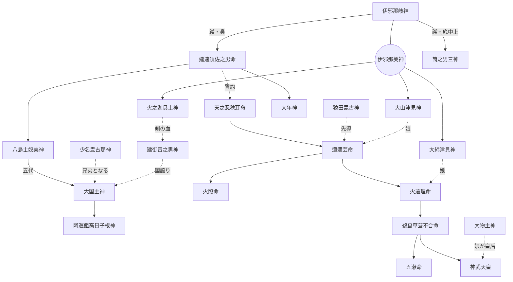

# 古事記の男神 目次

『古事記』（712年〈皇紀1372年・和銅5年〉成立）に登場する男神を、一柱につき一ファイルで解説する資料集の目次です。

- 収録数：**79柱**（上巻 74柱／中巻 5柱。五瀬命は上巻末に生まれ、中巻で活躍する）
- 配列：おおむね古事記本文での初出順
- 関連目次：[古事記の女神](../goddesses/README.md)／[古事記の男女の区別の無い神](../neutral_deities/README.md)

---

## 凡例

1. **収録基準**：古事記本文に登場する名のある神のうち、下記「性別の判定基準」で男神と判定した神を収録した。国生みで生まれた島の亦の名（「別」「比古」を含むもの）も、国土の神格化として収録した。中巻以降は、本文で「神」と記され、男性と判定できる神のみを収録した。
2. **表記**：神名は古事記本文の表記を優先し、『日本書紀』等の表記は各ファイルの「別名・異表記」に示した。歴史用語は漢字表記を優先した。
3. **読み**：現代仮名遣いで示した。注釈書により読みが異なる場合は各ファイルに併記した。
4. **年の表記**：「西暦年（皇紀〇年・和暦〇年）」の形式とした。和暦制定以前は天皇の治世年（『日本書紀』紀年）を示し、その旨を注記した。
5. **本文引用**：古事記・日本書紀の引用は訓読（書き下し）で示した。訓みは注釈書によって異なるため、厳密な引用には校訂本文を参照されたい。歌謡・詞章の現代語訳は大意である。
6. **不確実な情報**：名義（神名の語源）解釈、比定地、現行の祭神構成、史料の細部など、確証のない情報には「※諸説あり」「※推定」「※要確認」「※未確認」等を付した。
7. **専門用語**：主要な学術用語は「英語（日本語訳）」または「日本語（英語）」の形で示した。
8. **構成**：各ファイルは「基本情報（性別の判定根拠を含む）」「概要」「概説」「エピソード」「『日本書紀』等との比較」「祭祀」「参考資料」で構成した。

### 性別の判定基準（男神／男女の区別の無い神）
古事記本文の記述を第一の根拠とし、次の基準で分類した。各ファイルの「性別の判定」欄に根拠を記している。

| 区分 | 判定基準 |
|---|---|
| 男神 | ① 神名に男性を示す語を含む：毘古・比古・日子（ひこ）、男・壮夫（を・をとこ）、那岐・那芸（なぎ）、別（わけ） ② 本文に「男子」「父」「兄（いろせ・那勢）」などと記される ③ 系譜で女神を「娶りて」子を生む（夫として記される） ④ 神世七代で「妹」を付された女神と対をなす兄神 |
| 男女の区別の無い神 | ① 「独神（ひとりがみ）」と明記される神 ② 上記の男神・女神の基準のいずれにも当たらない神（性別を示す語・婚姻・父母としての記述がない神） ③ 「〜神の女（むすめ）」の親として名が見えるのみの神（「女」は娘の意で、親の性別を示さない） |
| 女神 | [古事記の女神](../goddesses/README.md)を参照（比売・毘売・売・女・妹を含む神、妻として記される神など） |

**注意**：この分類は「古事記本文に性別が明示されているか」による形式的な区分である。たとえば[月読命](../neutral_deities/067_月読命.md)・[事代主神](../neutral_deities/106_事代主神.md)・[建御名方神](../neutral_deities/107_建御名方神.md)・[天児屋命](../neutral_deities/072_天児屋命.md)などは、後世の信仰や『日本書紀』『万葉集』の表現から一般に男神と理解されているが、古事記本文に性別の記述がないため「男女の区別の無い神」に分類した。逆に「別（わけ）」を男性の称号とみなす判定は通説に従ったもので、異論もありうる。境界的な例（[宇摩志阿斯訶備比古遅神](../neutral_deities/004_宇摩志阿斯訶備比古遅神.md)〈独神だが名に「比古遅」〉、[天石門別神](../neutral_deities/110_天石門別神.md)〈「別」を含む〉、[沫那芸神](025_沫那芸神.md)〈「那芸」を凪と解する説〉など）は、各ファイルに判断の理由を記した。

---

## 一覧

### 第一部　神世七代

| No. | 神名 | 読み | 神格 | 登場箇所 | 区分 |
|---|---|---|---|---|---|
| 001 | [宇比地邇神](001_宇比地邇神.md) | うひぢにのかみ | 泥土の神、大地形成の神 | 上巻「神世七代」 | 系譜・名のみ |
| 002 | [角杙神](002_角杙神.md) | つのぐいのかみ | 杭（境界）・萌芽の神 | 上巻「神世七代」 | 系譜・名のみ |
| 003 | [意富斗能地神](003_意富斗能地神.md) | おおとのぢのかみ | 大いなる戸・殿（住居）の神 | 上巻「神世七代」 | 系譜・名のみ |
| 004 | [淤母陀琉神](004_淤母陀琉神.md) | おもだるのかみ | 容貌の完成を表す神。後世、第六天神として信仰 | 上巻「神世七代」 | 系譜・名のみ |
| 005 | [伊邪那岐神](005_伊邪那岐神.md) | いざなきのかみ | 国土・万物を生んだ父神、禊祓の祖、三貴子の父 | 上巻「神世七代」「国生み」「神生み」「火神殺し」「黄泉国」「禊祓」「三貴子の分治」 | **主要** |

### 第二部　国生み（島の亦の名）

| No. | 神名 | 読み | 神格 | 登場箇所 | 区分 |
|---|---|---|---|---|---|
| 006 | [飯依比古](006_飯依比古.md) | いいよりひこ | 讃岐国（現・香川県）の国魂 | 上巻「国生み」（伊予之二名島の一面） | 系譜・名のみ |
| 007 | [建依別](007_建依別.md) | たけよりわけ | 土左国（現・高知県）の国魂 | 上巻「国生み」（伊予之二名島の一面） | 系譜・名のみ |
| 008 | [白日別](008_白日別.md) | しらひわけ | 筑紫国（現・福岡県の大部分）の国魂 | 上巻「国生み」（筑紫島の一面） | 系譜・名のみ |
| 009 | [豊日別](009_豊日別.md) | とよひわけ | 豊国（現・福岡県東部と大分県）の国魂 | 上巻「国生み」（筑紫島の一面） | 系譜・名のみ |
| 010 | [建日向日豊久士比泥別](010_建日向日豊久士比泥別.md) | たけひむかひとよくじひねわけ | 肥国（現・佐賀県・長崎県・熊本県）の国魂 | 上巻「国生み」（筑紫島の一面） | 系譜・名のみ |
| 011 | [建日別](011_建日別.md) | たけひわけ | 熊曾国（南九州）の国魂 | 上巻「国生み」（筑紫島の一面） | 系譜・名のみ |
| 012 | [天之忍許呂別](012_天之忍許呂別.md) | あめのおしころわけ | 隠伎之三子島（隠岐諸島）の国魂 | 上巻「国生み」 | 系譜・名のみ |
| 013 | [天御虚空豊秋津根別](013_天御虚空豊秋津根別.md) | あまつみそらとよあきつねわけ | 大倭豊秋津島（本州）の国魂 | 上巻「国生み」 | 系譜・名のみ |
| 014 | [建日方別](014_建日方別.md) | たけひかたわけ | 吉備児島（現・岡山県児島半島）の国魂 | 上巻「国生み」（大八島国の後の六島） | 系譜・名のみ |
| 015 | [大多麻流別](015_大多麻流別.md) | おおたまるわけ | 大島の国魂 | 上巻「国生み」（大八島国の後の六島） | 系譜・名のみ |
| 016 | [天之忍男](016_天之忍男.md) | あめのおしお | 知訶島（現・長崎県五島列島）の国魂 | 上巻「国生み」（大八島国の後の六島） | 系譜・名のみ |

### 第三部　神生み

| No. | 神名 | 読み | 神格 | 登場箇所 | 区分 |
|---|---|---|---|---|---|
| 017 | [大事忍男神](017_大事忍男神.md) | おおことおしおのかみ | 大事業（神生み）を成し遂げる神 | 上巻「神生み」（最初の神） | 系譜・名のみ |
| 018 | [石土毘古神](018_石土毘古神.md) | いわつちびこのかみ | 石と土の神、家屋の土台の神 | 上巻「神生み」 | 系譜・名のみ |
| 019 | [大戸日別神](019_大戸日別神.md) | おおとひわけのかみ | 家屋の大きな戸口の神 | 上巻「神生み」 | 系譜・名のみ |
| 020 | [天之吹男神](020_天之吹男神.md) | あめのふきおのかみ | 屋根を葺く神 | 上巻「神生み」 | 系譜・名のみ |
| 021 | [大屋毘古神](021_大屋毘古神.md) | おおやびこのかみ | 家屋の神。木国（紀伊国）の神として大穴牟遅神を救う | 上巻「神生み」「八十神の迫害（木国の大屋毘古神）」 | 準主要 |
| 022 | [風木津別之忍男神](022_風木津別之忍男神.md) | かざもつわけのおしおのかみ | 家屋を風から守る神 | 上巻「神生み」 | 系譜・名のみ |
| 023 | [大綿津見神](023_大綿津見神.md) | おおわたつみのかみ | 海の神、海の宮の主 | 上巻「神生み」「海佐知山佐知（綿津見神の宮）」 | **主要** |
| 024 | [速秋津日子神](024_速秋津日子神.md) | はやあきつひこのかみ | 河口・港（水門）の神 | 上巻「神生み」 | 準主要 |
| 025 | [沫那芸神](025_沫那芸神.md) | あわなぎのかみ | 水の泡（水面の泡立ち）の神 | 上巻「神生み」（速秋津日子神・速秋津比売神の御子） | 系譜・名のみ |
| 026 | [頬那芸神](026_頬那芸神.md) | つらなぎのかみ | 水面の神 | 上巻「神生み」（速秋津日子神・速秋津比売神の御子） | 系譜・名のみ |
| 027 | [志那都比古神](027_志那都比古神.md) | しなつひこのかみ | 風の神 | 上巻「神生み」 | 系譜・名のみ |
| 028 | [大山津見神](028_大山津見神.md) | おおやまつみのかみ | 山の神、山を司る国つ神の長 | 上巻「神生み」「八俣遠呂智（足名椎の父）」「須佐之男命の系譜」「天孫降臨後（木花之佐久夜毘売の父）」 | **主要** |
| 029 | [大戸惑子神](029_大戸惑子神.md) | おおとまといこのかみ | 山中の大きな谷・峠で人を迷わせる神 | 上巻「神生み」（大山津見神・野椎神の御子） | 系譜・名のみ |
| 030 | [火之迦具土神](030_火之迦具土神.md) | ひのかぐつちのかみ | 火の神 | 上巻「神生み」「伊邪那美神の死」「火神殺し」 | **主要** |
| 031 | [金山毘古神](031_金山毘古神.md) | かなやまびこのかみ | 鉱山・金属・鍛冶の神 | 上巻「神生み」（伊邪那美神の病臥） | 系譜・名のみ |
| 032 | [波邇夜須毘古神](032_波邇夜須毘古神.md) | はにやすびこのかみ | 粘土（埴）の神、土の神 | 上巻「神生み」（伊邪那美神の病臥） | 系譜・名のみ |

### 第四部　火神殺し

| No. | 神名 | 読み | 神格 | 登場箇所 | 区分 |
|---|---|---|---|---|---|
| 033 | [石筒之男神](033_石筒之男神.md) | いわつつのおのかみ | 岩の霊威（剣の霊威）の神 | 上巻「火神殺し」 | 系譜・名のみ |
| 034 | [建御雷之男神](034_建御雷之男神.md) | たけみかづちのおのかみ | 雷神・剣の神・武神。葦原中国平定の主役 | 上巻「火神殺し」「葦原中国平定（国譲り）」、中巻「神武天皇記（熊野での布都御魂）」 | **主要** |

### 第五部　禊祓・三貴子

| No. | 神名 | 読み | 神格 | 登場箇所 | 区分 |
|---|---|---|---|---|---|
| 035 | [奥津那芸佐毘古神](035_奥津那芸佐毘古神.md) | おきつなぎさびこのかみ | 奥（おき＝沖）の渚の神 | 上巻「伊邪那岐命の禊祓」 | 系譜・名のみ |
| 036 | [辺津那芸佐毘古神](036_辺津那芸佐毘古神.md) | へつなぎさびこのかみ | 辺（へ＝岸辺）の渚の神 | 上巻「伊邪那岐命の禊祓」 | 系譜・名のみ |
| 037 | [底筒之男命](037_底筒之男命.md) | そこつつのおのみこと | 航海・海上交通の神、住吉大神 | 上巻「伊邪那岐命の禊祓」、中巻「仲哀天皇記（神功皇后の新羅遠征）」 | **主要** |
| 038 | [中筒之男命](038_中筒之男命.md) | なかつつのおのみこと | 航海・海上交通の神、住吉大神 | 上巻「伊邪那岐命の禊祓」、中巻「仲哀天皇記（神功皇后の新羅遠征）」 | **主要** |
| 039 | [上筒之男命](039_上筒之男命.md) | うわつつのおのみこと | 航海・海上交通の神、住吉大神 | 上巻「伊邪那岐命の禊祓」、中巻「仲哀天皇記（神功皇后の新羅遠征）」 | **主要** |
| 040 | [建速須佐之男命](040_建速須佐之男命.md) | たけはやすさのおのみこと | 荒ぶる神・暴風雨の神、八俣遠呂智を退治した英雄神、根の堅州国の主、出雲系の祖神 | 上巻「三貴子の誕生」「天安河の誓約」「天石屋戸」「大気都比売神」「八俣遠呂智」「須賀の宮」「根の堅州国」 | **主要** |

### 第六部　天安河の誓約・天石屋戸

| No. | 神名 | 読み | 神格 | 登場箇所 | 区分 |
|---|---|---|---|---|---|
| 041 | [天之忍穂耳命](041_天之忍穂耳命.md) | あめのおしほみみのみこと | 天照大御神の長子、天孫の父、稲穂の神 | 上巻「天安河の誓約」「葦原中国平定」「天孫降臨」 | **主要** |
| 042 | [天之菩卑能命](042_天之菩卑能命.md) | あめのほひのみこと | 稲穂の霊の神、出雲国造家の祖神 | 上巻「天安河の誓約」「葦原中国平定（最初の使者）」 | **主要** |
| 043 | [天津日子根命](043_天津日子根命.md) | あまつひこねのみこと | 多くの氏族の祖神 | 上巻「天安河の誓約」 | 系譜・名のみ |
| 044 | [活津日子根命](044_活津日子根命.md) | いくつひこねのみこと | 誓約の五男神の一柱 | 上巻「天安河の誓約」 | 系譜・名のみ |
| 045 | [熊野久須毘命](045_熊野久須毘命.md) | くまのくすびのみこと | 誓約の五男神の一柱、霊妙な力の神 | 上巻「天安河の誓約」 | 系譜・名のみ |
| 046 | [天手力男神](046_天手力男神.md) | あめのたぢからおのかみ | 腕力の神、天石屋戸を開いた神、伊勢神宮内宮の相殿神 | 上巻「天石屋戸」「天孫降臨」 | **主要** |

### 第七部　出雲（須佐之男命から大国主神への系譜）

| No. | 神名 | 読み | 神格 | 登場箇所 | 区分 |
|---|---|---|---|---|---|
| 047 | [足名椎](047_足名椎.md) | あしなづち | 国つ神、稲田の宮の首長 | 上巻「八俣遠呂智退治」「須賀の宮」 | **主要** |
| 048 | [八島士奴美神](048_八島士奴美神.md) | やしまじぬみのかみ | 大八島国を治める神（名義から）、大国主神の祖 | 上巻「須佐之男命の系譜」 | 準主要 |
| 049 | [大年神](049_大年神.md) | おおとしのかみ | 稲の実り（年）の神、穀物神、正月の年神 | 上巻「須佐之男命の系譜」「大年神の系譜」 | 準主要 |
| 050 | [布波能母遅久奴須奴神](050_布波能母遅久奴須奴神.md) | ふわのもぢくぬすぬのかみ | 未詳 | 上巻「須佐之男命の系譜」 | 系譜・名のみ |
| 051 | [深淵之水夜礼花神](051_深淵之水夜礼花神.md) | ふかふちのみずやれはなのかみ | 深い淵の水の神（名義から） | 上巻「須佐之男命の系譜」 | 系譜・名のみ |
| 052 | [淤美豆奴神](052_淤美豆奴神.md) | おみずぬのかみ | 大いなる水の主、出雲国の国引きの神 | 上巻「須佐之男命の系譜」 | 系譜・名のみ |
| 053 | [天之冬衣神](053_天之冬衣神.md) | あめのふゆきぬのかみ | 大国主神の父 | 上巻「須佐之男命の系譜」 | 系譜・名のみ |

### 第八部　大国主神とその子孫

| No. | 神名 | 読み | 神格 | 登場箇所 | 区分 |
|---|---|---|---|---|---|
| 054 | [大国主神](054_大国主神.md) | おおくにぬしのかみ | 国作りの神、葦原中国の主、国譲りの神、縁結び・医療・農業の神 | 上巻「稲羽の素菟」「八十神の迫害」「根の堅州国」「八千矛神の妻問い」「神語」「大国主神の系譜」「国作り」「国譲り」、中巻「垂仁天皇記（出雲大神）」 | **主要** |
| 055 | [少名毘古那神](055_少名毘古那神.md) | すくなびこなのかみ | 国作りの神、医薬・まじない・酒・温泉の神、常世の神 | 上巻「国作り」、中巻「仲哀天皇記（酒楽の歌）」 | **主要** |
| 056 | [久延毘古](056_久延毘古.md) | くえびこ | 案山子（かかし）の神、知恵・学問の神、田の神 | 上巻「国作り（少名毘古那神の来訪）」 | 系譜・名のみ |
| 057 | [阿遅鉏高日子根神](057_阿遅鉏高日子根神.md) | あじすきたかひこねのかみ | 鋤（農具）の神、雷神、葛城の鴨氏の神 | 上巻「大国主神の系譜」「天若日子の葬儀」 | **主要** |
| 058 | [鳥鳴海神](058_鳥鳴海神.md) | とりなるみのかみ | 未詳（大国主神の子孫） | 上巻「大国主神の系譜」 | 系譜・名のみ |
| 059 | [国忍富神](059_国忍富神.md) | くにおしとみのかみ | 未詳（大国主神の子孫） | 上巻「大国主神の系譜」 | 系譜・名のみ |
| 060 | [速甕之多気佐波夜遅奴美神](060_速甕之多気佐波夜遅奴美神.md) | はやみかのたけさはやぢぬみのかみ | 未詳（大国主神の子孫） | 上巻「大国主神の系譜」 | 系譜・名のみ |
| 061 | [甕主日子神](061_甕主日子神.md) | みかぬしひこのかみ | 未詳（大国主神の子孫） | 上巻「大国主神の系譜」 | 系譜・名のみ |
| 062 | [多比理岐志麻流美神](062_多比理岐志麻流美神.md) | たひりきしまるみのかみ | 未詳（大国主神の子孫） | 上巻「大国主神の系譜」 | 系譜・名のみ |
| 063 | [美呂浪神](063_美呂浪神.md) | みろなみのかみ | 未詳（大国主神の子孫） | 上巻「大国主神の系譜」 | 系譜・名のみ |
| 064 | [布忍富鳥鳴海神](064_布忍富鳥鳴海神.md) | ぬのおしとみとりなるみのかみ | 未詳（大国主神の子孫） | 上巻「大国主神の系譜」 | 系譜・名のみ |
| 065 | [天日腹大科度美神](065_天日腹大科度美神.md) | あめのひばらおおしなどみのかみ | 未詳（大国主神の子孫） | 上巻「大国主神の系譜」 | 系譜・名のみ |

### 第九部　大年神の系譜

| No. | 神名 | 読み | 神格 | 登場箇所 | 区分 |
|---|---|---|---|---|---|
| 066 | [奥津日子神](066_奥津日子神.md) | おきつひこのかみ | 竈（かまど）の神 | 上巻「大年神の系譜」 | 系譜・名のみ |
| 067 | [羽山戸神](067_羽山戸神.md) | はやまとのかみ | 山の麓（端山）の神、稲作の一年を表す八神の父 | 上巻「大年神の系譜」 | 準主要 |

### 第十部　葦原中国平定・天孫降臨

| No. | 神名 | 読み | 神格 | 登場箇所 | 区分 |
|---|---|---|---|---|---|
| 068 | [天若日子](068_天若日子.md) | あめのわかひこ | 天つ神の使者、使命に背いた神 | 上巻「葦原中国平定（二番目の使者）」 | **主要** |
| 069 | [天津国玉神](069_天津国玉神.md) | あまつくにたまのかみ | 天上の国の霊 | 上巻「葦原中国平定（天若日子の段）」 | **主要** |
| 070 | [邇邇芸命](070_邇邇芸命.md) | ににぎのみこと | 天孫、稲穂の神、皇室の祖 | 上巻「天孫降臨」「木花之佐久夜毘売との婚姻」「火中出産」 | **主要** |
| 071 | [猿田毘古神](071_猿田毘古神.md) | さるたびこのかみ | 天孫降臨の先導神、道の神（道開き）、伊勢の地主神 | 上巻「天孫降臨」「猿田毘古神の溺死」 | **主要** |

### 第十一部　日向（日向三代）

| No. | 神名 | 読み | 神格 | 登場箇所 | 区分 |
|---|---|---|---|---|---|
| 072 | [火照命](072_火照命.md) | ほでりのみこと | 海の幸の神、隼人の祖 | 上巻「火中出産」「海佐知山佐知」 | **主要** |
| 073 | [火遠理命](073_火遠理命.md) | ほおりのみこと | 山の幸の神、海神の婿、天皇家の祖（神武天皇の祖父） | 上巻「火中出産」「海佐知山佐知」「綿津見神の宮」「鵜葺草葺不合命の誕生」 | **主要** |
| 074 | [鵜葺草葺不合命](074_鵜葺草葺不合命.md) | うがやふきあえずのみこと | 海辺の産屋で生まれた神、神武天皇の父、日向三代の第三代 | 上巻「鵜葺草葺不合命の誕生」「鵜葺草葺不合命の系譜」 | **主要** |

### 第十二部　中巻（人代に登場する神）

| No. | 神名 | 読み | 神格 | 登場箇所 | 区分 |
|---|---|---|---|---|---|
| 075 | [五瀬命](075_五瀬命.md) | いつせのみこと | 神武天皇の同母兄、東征の将 | 上巻「鵜葺草葺不合命の系譜」、中巻「神武天皇記（東征）」 | **主要** |
| 076 | [邇芸速日命](076_邇芸速日命.md) | にぎはやひのみこと | 天つ神の御子として大和に先に天降った神、物部氏の祖神 | 中巻「神武天皇記（東征）」 | 準主要 |
| 077 | [大物主神](077_大物主神.md) | おおものぬしのかみ | 三輪山の神、国作りを助ける神、疫病の神・国家守護の神、蛇神 | 上巻「国作り（御諸山の神）」、中巻「神武天皇記（伊須気余理比売の誕生）」「崇神天皇記（疫病と三輪山伝説）」 | **主要** |
| 078 | [秋山之下氷壮夫](078_秋山之下氷壮夫.md) | あきやまのしたびおとこ | 秋（紅葉）の山の神 | 中巻「応神天皇記（秋山之下氷壮夫と春山之霞壮夫）」 | **主要** |
| 079 | [春山之霞壮夫](079_春山之霞壮夫.md) | はるやまのかすみおとこ | 春（霞）の山の神 | 中巻「応神天皇記（秋山之下氷壮夫と春山之霞壮夫）」 | **主要** |

**区分の目安**：**主要**＝複数の場面で行為・発話を伴うエピソードを持つ神、または解説の分量が多い神／準主要＝特定の場面で役割を持つ神／系譜・名のみ＝古事記では系譜記事や名の列挙にのみ現れる神（自動判定に基づく目安）

---

## 主要な男神の系譜関係（略図）

（実線＝親子・婚姻、点線＝誓約・化成・その他の関係。二重丸は女神。表示の都合上、多くの神を省略している）

---

## 参考：収録しなかった存在

| 名 | 理由・備考 |
|---|---|
| 天皇・皇族（神倭伊波礼毘古命〈神武天皇〉以降）、倭建命など | 人代の人物（中巻・下巻）。ただし神武天皇の兄（五瀬命・稲氷命・御毛沼命）は上巻に生まれるため収録した |
| 高志之八俣遠呂智 | 「神」と記されない怪物（大蛇）（→[建速須佐之男命](040_建速須佐之男命.md)） |
| 八十神 | 大国主神の兄弟の神々の総称で、個別の名がない（→[大国主神](054_大国主神.md)） |
| 黄泉神・黄泉軍・予母都志許売 | 個別の名を持たない集団（→[伊邪那岐神](005_伊邪那岐神.md)） |
| 常世の長鳴鳥、雉名鳴女、八咫烏、多邇具久、和邇、鼠 | 神の使い・動物（八咫烏は高木大神が遣わした鳥）。「稲羽之素菟」は「菟神」と明記されるため収録した |
| 熊野の荒ぶる神（大熊）、坂の御尾の神・河の瀬の神 | 固有の名がない。景行記の三神（走水・足柄・伊服岐）は、物語上の役割が大きいため例外として収録した |
| 出雲大神（垂仁記）、墨江大神（仲哀記） | それぞれ大国主神・筒之男三神と同一とされるため、各ファイルで扱った |
| 天之日矛、高倉下、登美能那賀須泥毘古など | 人として描かれる存在 |
| 経津主神、五十猛神、天目一箇神、菊理媛神など | 『日本書紀』等にのみ登場し、古事記には見えない（関連する神のファイルで言及） |

---

## 主要参考文献

### 一次資料
- 『古事記』（712年〈皇紀1372年・和銅5年〉成立）。最古写本は真福寺本（1371〜1372年〈皇紀2031〜2032年・応安4〜5年〉書写、国宝）
- 『日本書紀』（720年〈皇紀1380年・養老4年〉成立）
- 『出雲国風土記』（733年〈皇紀1393年・天平5年〉成立）、その他諸国風土記・逸文
- 『万葉集』（8世紀後半成立）
- 『止由気宮儀式帳』『皇太神宮儀式帳』（804年〈皇紀1464年・延暦23年〉撰進）
- 『古語拾遺』斎部広成撰（807年〈皇紀1467年・大同2年〉成立）
- 『新撰姓氏録』（815年〈皇紀1475年・弘仁6年〉成立）
- 『延喜式』（927年〈皇紀1587年・延長5年〉撰進）神名帳・祝詞
- 『先代旧事本紀』（平安時代初期成立とされる。成立年代・史料的価値には議論がある）

### 校訂本文・注釈書
- 本居宣長『古事記伝』（1798年〈皇紀2458年・寛政10年〉完成）
- 倉野憲司・武田祐吉 校注『古事記 祝詞』（日本古典文学大系1）岩波書店、1958年（皇紀2618年・昭和33年）
- 西郷信綱『古事記注釈』平凡社、1975〜1989年（皇紀2635〜2649年・昭和50〜平成元年）
- 山口佳紀・神野志隆光 校注・訳『古事記』（新編日本古典文学全集1）小学館、1997年（皇紀2657年・平成9年）
- 坂本太郎ほか 校注『日本書紀』（日本古典文学大系67・68）岩波書店、1965〜1967年（皇紀2625〜2627年・昭和40〜42年）

### 研究書
- 柳田國男『妹の力』創元社、1940年（皇紀2600年・昭和15年）
- 大林太良『日本神話の起源』角川書店、1961年（皇紀2621年・昭和36年）
- 松前健『日本神話の形成』塙書房、1970年（皇紀2630年・昭和45年）
- 三品彰英『日鮮神話伝説の研究』（三品彰英論文集第4巻）平凡社、1972年（皇紀2632年・昭和47年）
- 溝口睦子『アマテラスの誕生』岩波新書、2009年（皇紀2669年・平成21年）

### オンライン資料
- 國學院大學 古事記学センター「古事記ビューア」「神名データベース」（https://kojiki.kokugakuin.ac.jp/）

## 留意事項
- 本資料は注釈書・研究書の通説に基づいて作成したが、一部の記述（特に名義の解釈、神社の現祭神、史料の細部）は一次資料で直接照合できていないものを含む。該当箇所には「※要確認」等を付しているので、研究・引用に用いる場合は上記の校訂本文・各社の由緒で確認されたい。
- 神社の祭神構成は時代により変遷しており、同じ神社でも資料によって記載が異なる場合がある。
