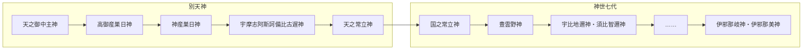

# 古事記の男女の区別の無い神 目次

『古事記』（712年〈皇紀1372年・和銅5年〉成立）に登場する神のうち、本文に性別の区別が示されていない神を、一柱につき一ファイルで解説する資料集の目次です。

- 収録数：**133柱**（上巻 120柱／中巻 12柱／下巻 1柱）
- 配列：おおむね古事記本文での初出順
- 関連目次：[古事記の女神](../goddesses/README.md)／[古事記の男神](../male_deities/README.md)

---

## 凡例

1. **収録基準**：古事記本文に登場する名のある神のうち、下記「性別の判定基準」で男女の区別の無い神と判定した神を収録した。独神のほか、自然・器物・身体部位などから成った神、系譜に親としてのみ名が見える神、神格化された宝物（剣・玉）、中巻・下巻で「神」と記される存在（固有名のない坂の神・山の神を一部含む）を収録した。
2. **表記**：神名は古事記本文の表記を優先し、『日本書紀』等の表記は各ファイルの「別名・異表記」に示した。歴史用語は漢字表記を優先した。
3. **読み**：現代仮名遣いで示した。注釈書により読みが異なる場合は各ファイルに併記した。
4. **年の表記**：「西暦年（皇紀〇年・和暦〇年）」の形式とした。和暦制定以前は天皇の治世年（『日本書紀』紀年）を示し、その旨を注記した。
5. **本文引用**：古事記・日本書紀の引用は訓読（書き下し）で示した。訓みは注釈書によって異なるため、厳密な引用には校訂本文を参照されたい。歌謡・詞章の現代語訳は大意である。
6. **不確実な情報**：名義（神名の語源）解釈、比定地、現行の祭神構成、史料の細部など、確証のない情報には「※諸説あり」「※推定」「※要確認」「※未確認」等を付した。
7. **専門用語**：主要な学術用語は「英語（日本語訳）」または「日本語（英語）」の形で示した。
8. **構成**：各ファイルは「基本情報（性別の判定根拠を含む）」「概要」「概説」「エピソード」「『日本書紀』等との比較」「祭祀」「参考資料」で構成した。

### 性別の判定基準（男神／男女の区別の無い神）
古事記本文の記述を第一の根拠とし、次の基準で分類した。各ファイルの「性別の判定」欄に根拠を記している。

| 区分 | 判定基準 |
|---|---|
| 男神 | ① 神名に男性を示す語を含む：毘古・比古・日子（ひこ）、男・壮夫（を・をとこ）、那岐・那芸（なぎ）、別（わけ） ② 本文に「男子」「父」「兄（いろせ・那勢）」などと記される ③ 系譜で女神を「娶りて」子を生む（夫として記される） ④ 神世七代で「妹」を付された女神と対をなす兄神 |
| 男女の区別の無い神 | ① 「独神（ひとりがみ）」と明記される神 ② 上記の男神・女神の基準のいずれにも当たらない神（性別を示す語・婚姻・父母としての記述がない神） ③ 「〜神の女（むすめ）」の親として名が見えるのみの神（「女」は娘の意で、親の性別を示さない） |
| 女神 | [古事記の女神](../goddesses/README.md)を参照（比売・毘売・売・女・妹を含む神、妻として記される神など） |

**注意**：この分類は「古事記本文に性別が明示されているか」による形式的な区分である。たとえば[月読命](067_月読命.md)・[事代主神](106_事代主神.md)・[建御名方神](107_建御名方神.md)・[天児屋命](072_天児屋命.md)などは、後世の信仰や『日本書紀』『万葉集』の表現から一般に男神と理解されているが、古事記本文に性別の記述がないため「男女の区別の無い神」に分類した。逆に「別（わけ）」を男性の称号とみなす判定は通説に従ったもので、異論もありうる。境界的な例（[宇摩志阿斯訶備比古遅神](004_宇摩志阿斯訶備比古遅神.md)〈独神だが名に「比古遅」〉、[天石門別神](110_天石門別神.md)〈「別」を含む〉、[沫那芸神](../male_deities/025_沫那芸神.md)〈「那芸」を凪と解する説〉など）は、各ファイルに判断の理由を記した。

---

## 一覧

### 第一部　天地初発（別天神・独神）

| No. | 神名 | 読み | 神格 | 登場箇所 | 区分 |
|---|---|---|---|---|---|
| 001 | [天之御中主神](001_天之御中主神.md) | あめのみなかぬしのかみ | 天の中心の主宰神、宇宙の根源神（後世の解釈） | 上巻「天地初発」 | 系譜・名のみ |
| 002 | [高御産巣日神](002_高御産巣日神.md) | たかみむすひのかみ | 生成の霊力の神、天孫降臨を命じる高天原の司令神、皇祖神（天照大御神とともに） | 上巻「天地初発」「天石屋戸（思金神の親）」「葦原中国平定」「天若日子（返し矢）」「天孫降臨」、中巻「神武天皇記（八咫烏）」 | **主要** |
| 003 | [神産巣日神](003_神産巣日神.md) | かみむすひのかみ | 生成の霊力の神、出雲系の神々を支える「御祖」 | 上巻「天地初発」「五穀の起源」「八十神の迫害（大穴牟遅神の蘇生）」「少名毘古那神」「国譲り（櫛八玉神の火鑽り）」 | **主要** |
| 004 | [宇摩志阿斯訶備比古遅神](004_宇摩志阿斯訶備比古遅神.md) | うましあしかびひこぢのかみ | 葦の芽の生命力の神 | 上巻「天地初発」 | 系譜・名のみ |
| 005 | [天之常立神](005_天之常立神.md) | あめのとこたちのかみ | 天の永遠の存立を表す神 | 上巻「天地初発」 | 系譜・名のみ |
| 006 | [国之常立神](006_国之常立神.md) | くにのとこたちのかみ | 国土の永遠の存立を表す神、根源神（後世の神道説） | 上巻「神世七代」 | 系譜・名のみ |
| 007 | [豊雲野神](007_豊雲野神.md) | とよくもぬのかみ | 豊かな雲（あるいは豊かな野）の神 | 上巻「神世七代」 | 系譜・名のみ |

### 第二部　国生み（水蛭子・島の亦の名）

| No. | 神名 | 読み | 神格 | 登場箇所 | 区分 |
|---|---|---|---|---|---|
| 008 | [水蛭子](008_水蛭子.md) | ひるこ | 国生みの最初に生まれた子。後世は漂着神・福神（えびす） | 上巻「国生み（最初の失敗）」 | 系譜・名のみ |
| 009 | [天比登都柱](009_天比登都柱.md) | あめのひとつばしら | 伊伎島（壱岐）の国魂 | 上巻「国生み」 | 系譜・名のみ |
| 010 | [天一根](010_天一根.md) | あめひとつね | 女島の国魂 | 上巻「国生み」 | 系譜・名のみ |
| 011 | [天両屋](011_天両屋.md) | あめふたや | 両児島の国魂 | 上巻「国生み」 | 系譜・名のみ |

### 第三部　神生み

| No. | 神名 | 読み | 神格 | 登場箇所 | 区分 |
|---|---|---|---|---|---|
| 012 | [天之水分神](012_天之水分神.md) | あめのみくまりのかみ | 水の分配（分水嶺・灌漑用水）の神 | 上巻「神生み」（速秋津日子神・速秋津比売神の御子） | 系譜・名のみ |
| 013 | [国之水分神](013_国之水分神.md) | くにのみくまりのかみ | 水の分配（分水嶺・灌漑用水）の神 | 上巻「神生み」（速秋津日子神・速秋津比売神の御子） | 系譜・名のみ |
| 014 | [天之久比奢母智神](014_天之久比奢母智神.md) | あめのくひざもちのかみ | 水を汲む瓢（ひさご）の神、灌漑の神 | 上巻「神生み」（速秋津日子神・速秋津比売神の御子） | 系譜・名のみ |
| 015 | [国之久比奢母智神](015_国之久比奢母智神.md) | くにのくひざもちのかみ | 水を汲む瓢（ひさご）の神、灌漑の神 | 上巻「神生み」（速秋津日子神・速秋津比売神の御子） | 系譜・名のみ |
| 016 | [久久能智神](016_久久能智神.md) | くくのちのかみ | 木の神 | 上巻「神生み」 | 系譜・名のみ |
| 017 | [天之狭土神](017_天之狭土神.md) | あめのさづちのかみ | 坂・狭い土地の神 | 上巻「神生み」（大山津見神・野椎神の御子） | 系譜・名のみ |
| 018 | [国之狭土神](018_国之狭土神.md) | くにのさづちのかみ | 坂・狭い土地の神 | 上巻「神生み」（大山津見神・野椎神の御子） | 系譜・名のみ |
| 019 | [天之狭霧神](019_天之狭霧神.md) | あめのさぎりのかみ | 霧（境界の霧）の神 | 上巻「神生み」（大山津見神・野椎神の御子） | 系譜・名のみ |
| 020 | [国之狭霧神](020_国之狭霧神.md) | くにのさぎりのかみ | 霧（境界の霧）の神 | 上巻「神生み」（大山津見神・野椎神の御子） | 系譜・名のみ |
| 021 | [天之闇戸神](021_天之闇戸神.md) | あめのくらどのかみ | 暗い谷間の神 | 上巻「神生み」（大山津見神・野椎神の御子） | 系譜・名のみ |
| 022 | [国之闇戸神](022_国之闇戸神.md) | くにのくらどのかみ | 暗い谷間の神 | 上巻「神生み」（大山津見神・野椎神の御子） | 系譜・名のみ |
| 023 | [鳥之石楠船神](023_鳥之石楠船神.md) | とりのいわくすぶねのかみ | 船の神、天と地を往来する神 | 上巻「神生み」「葦原中国平定（国譲り）」 | **主要** |
| 024 | [和久産巣日神](024_和久産巣日神.md) | わくむすひのかみ | 若々しい生成の霊力の神、穀物の生成の神 | 上巻「神生み」（伊邪那美神の病臥） | 系譜・名のみ |

### 第四部　火神殺し（剣の血と迦具土神の体から成った神）

| No. | 神名 | 読み | 神格 | 登場箇所 | 区分 |
|---|---|---|---|---|---|
| 025 | [石拆神](025_石拆神.md) | いわさくのかみ | 岩を裂く力の神 | 上巻「火神殺し」 | 系譜・名のみ |
| 026 | [根拆神](026_根拆神.md) | ねさくのかみ | 根を裂く力の神 | 上巻「火神殺し」 | 系譜・名のみ |
| 027 | [甕速日神](027_甕速日神.md) | みかはやひのかみ | 火の勢いの神（威力ある速い火の霊） | 上巻「火神殺し」 | 系譜・名のみ |
| 028 | [樋速日神](028_樋速日神.md) | ひはやひのかみ | 火の勢いの神（燃え盛る速い火の霊） | 上巻「火神殺し」 | 系譜・名のみ |
| 029 | [闇淤加美神](029_闇淤加美神.md) | くらおかみのかみ | 谷の水（雨）を司る龍神 | 上巻「火神殺し」 | 系譜・名のみ |
| 030 | [闇御津羽神](030_闇御津羽神.md) | くらみつはのかみ | 谷の水の神 | 上巻「火神殺し」 | 系譜・名のみ |
| 031 | [正鹿山津見神](031_正鹿山津見神.md) | まさかやまつみのかみ | 山の神（山の一部分の神） | 上巻「火神殺し」 | 系譜・名のみ |
| 032 | [淤縢山津見神](032_淤縢山津見神.md) | おどやまつみのかみ | 山の神（山の一部分の神） | 上巻「火神殺し」 | 系譜・名のみ |
| 033 | [奥山津見神](033_奥山津見神.md) | おくやまつみのかみ | 山の神（山の一部分の神） | 上巻「火神殺し」 | 系譜・名のみ |
| 034 | [闇山津見神](034_闇山津見神.md) | くらやまつみのかみ | 山の神（山の一部分の神） | 上巻「火神殺し」 | 系譜・名のみ |
| 035 | [志芸山津見神](035_志芸山津見神.md) | しぎやまつみのかみ | 山の神（山の一部分の神） | 上巻「火神殺し」 | 系譜・名のみ |
| 036 | [羽山津見神](036_羽山津見神.md) | はやまつみのかみ | 山の神（山の一部分の神） | 上巻「火神殺し」 | 系譜・名のみ |
| 037 | [原山津見神](037_原山津見神.md) | はらやまつみのかみ | 山の神（山の一部分の神） | 上巻「火神殺し」 | 系譜・名のみ |
| 038 | [戸山津見神](038_戸山津見神.md) | とやまつみのかみ | 山の神（山の一部分の神） | 上巻「火神殺し」 | 系譜・名のみ |
| 039 | [伊都之尾羽張神](039_伊都之尾羽張神.md) | いつのおはばりのかみ | 剣の神（伊邪那岐命が迦具土神を斬った十拳剣の神格化） | 上巻「火神殺し」「葦原中国平定（国譲り）」 | **主要** |

### 第五部　黄泉国

| No. | 神名 | 読み | 神格 | 登場箇所 | 区分 |
|---|---|---|---|---|---|
| 040 | [大雷](040_大雷.md) | おおいかづち | 雷神（大いなる雷）、黄泉の恐ろしい霊威 | 上巻「黄泉国訪問」 | 準主要 |
| 041 | [火雷](041_火雷.md) | ほのいかづち | 雷神（火（稲妻の光）の雷）、黄泉の恐ろしい霊威 | 上巻「黄泉国訪問」 | 準主要 |
| 042 | [黒雷](042_黒雷.md) | くろいかづち | 雷神（黒雲の雷）、黄泉の恐ろしい霊威 | 上巻「黄泉国訪問」 | 準主要 |
| 043 | [析雷](043_析雷.md) | さくいかづち | 雷神（物を裂く雷（落雷））、黄泉の恐ろしい霊威 | 上巻「黄泉国訪問」 | 準主要 |
| 044 | [若雷](044_若雷.md) | わかいかづち | 雷神（若々しい（勢いのある）雷）、黄泉の恐ろしい霊威 | 上巻「黄泉国訪問」 | 準主要 |
| 045 | [土雷](045_土雷.md) | つちいかづち | 雷神（地に落ちる雷）、黄泉の恐ろしい霊威 | 上巻「黄泉国訪問」 | 準主要 |
| 046 | [鳴雷](046_鳴雷.md) | なるいかづち | 雷神（鳴り響く雷）、黄泉の恐ろしい霊威 | 上巻「黄泉国訪問」 | 準主要 |
| 047 | [伏雷](047_伏雷.md) | ふすいかづち | 雷神（雲の中に伏して潜む雷）、黄泉の恐ろしい霊威 | 上巻「黄泉国訪問」 | 準主要 |
| 048 | [意富加牟豆美命](048_意富加牟豆美命.md) | おおかむづみのみこと | 桃（邪気を祓う果実）の神、人々を苦難から救う神 | 上巻「黄泉国訪問（黄泉比良坂）」 | 準主要 |
| 049 | [道反之大神](049_道反之大神.md) | ちがえしのおおかみ | 黄泉と現世の境を塞ぐ神（境界の神）、塞の神 | 上巻「黄泉国訪問（黄泉比良坂）」 | 準主要 |

### 第六部　禊祓・三貴子

| No. | 神名 | 読み | 神格 | 登場箇所 | 区分 |
|---|---|---|---|---|---|
| 050 | [衝立船戸神](050_衝立船戸神.md) | つきたつふなどのかみ | 道の分岐点・境界に立って災いを防ぐ神（岐の神・塞の神） | 上巻「伊邪那岐命の禊祓」 | 系譜・名のみ |
| 051 | [道之長乳歯神](051_道之長乳歯神.md) | みちのながちはのかみ | 長い道の神 | 上巻「伊邪那岐命の禊祓」 | 系譜・名のみ |
| 052 | [時量師神](052_時量師神.md) | ときはかしのかみ | 時を量る神、または物を解き放つ神 | 上巻「伊邪那岐命の禊祓」 | 系譜・名のみ |
| 053 | [和豆良比能宇斯能神](053_和豆良比能宇斯能神.md) | わずらいのうしのかみ | 煩い（災い・病）の主 | 上巻「伊邪那岐命の禊祓」 | 系譜・名のみ |
| 054 | [道俣神](054_道俣神.md) | ちまたのかみ | 道の分かれ目（巷）の神 | 上巻「伊邪那岐命の禊祓」 | 系譜・名のみ |
| 055 | [飽咋之宇斯能神](055_飽咋之宇斯能神.md) | あきぐいのうしのかみ | 穢れを食い尽くす主 | 上巻「伊邪那岐命の禊祓」 | 系譜・名のみ |
| 056 | [奥疎神](056_奥疎神.md) | おきざかるのかみ | 奥（沖）の海辺の神 | 上巻「伊邪那岐命の禊祓」 | 系譜・名のみ |
| 057 | [奥津甲斐弁羅神](057_奥津甲斐弁羅神.md) | おきつかいべらのかみ | 奥（沖）の海辺の神 | 上巻「伊邪那岐命の禊祓」 | 系譜・名のみ |
| 058 | [辺疎神](058_辺疎神.md) | へざかるのかみ | 辺（岸辺）の海辺の神 | 上巻「伊邪那岐命の禊祓」 | 系譜・名のみ |
| 059 | [辺津甲斐弁羅神](059_辺津甲斐弁羅神.md) | へつかいべらのかみ | 辺（岸辺）の海辺の神 | 上巻「伊邪那岐命の禊祓」 | 系譜・名のみ |
| 060 | [八十禍津日神](060_八十禍津日神.md) | やそまがつひのかみ | 多くの禍（災厄）の神 | 上巻「伊邪那岐命の禊祓」 | 系譜・名のみ |
| 061 | [大禍津日神](061_大禍津日神.md) | おおまがつひのかみ | 大いなる禍（災厄）の神 | 上巻「伊邪那岐命の禊祓」 | 系譜・名のみ |
| 062 | [神直毘神](062_神直毘神.md) | かむなおびのかみ | 禍を直す神聖な霊 | 上巻「伊邪那岐命の禊祓」 | 系譜・名のみ |
| 063 | [大直毘神](063_大直毘神.md) | おおなおびのかみ | 禍を直す大いなる霊 | 上巻「伊邪那岐命の禊祓」 | 系譜・名のみ |
| 064 | [底津綿津見神](064_底津綿津見神.md) | そこつわたつみのかみ | 海の神、阿曇連の祖神 | 上巻「伊邪那岐命の禊祓」 | 系譜・名のみ |
| 065 | [中津綿津見神](065_中津綿津見神.md) | なかつわたつみのかみ | 海の神、阿曇連の祖神 | 上巻「伊邪那岐命の禊祓」 | 系譜・名のみ |
| 066 | [上津綿津見神](066_上津綿津見神.md) | うわつわたつみのかみ | 海の神、阿曇連の祖神 | 上巻「伊邪那岐命の禊祓」 | 系譜・名のみ |
| 067 | [月読命](067_月読命.md) | つくよみのみこと | 月の神、夜の食国（おすくに）の統治者、暦の神 | 上巻「三貴子の誕生」 | 準主要 |
| 068 | [御倉板挙之神](068_御倉板挙之神.md) | みくらたなのかみ | 首飾りの玉の神、稲の霊（稲魂）を宿す神とされる | 上巻「三貴子の分治」 | 系譜・名のみ |

### 第七部　天石屋戸・誓約の後裔

| No. | 神名 | 読み | 神格 | 登場箇所 | 区分 |
|---|---|---|---|---|---|
| 069 | [思金神](069_思金神.md) | おもいかねのかみ | 知恵の神、思慮・計画の神 | 上巻「天石屋戸」「葦原中国平定」「天孫降臨」 | **主要** |
| 070 | [天津麻羅](070_天津麻羅.md) | あまつまら | 鍛冶（鍛人）の神 | 上巻「天石屋戸」 | 系譜・名のみ |
| 071 | [玉祖命](071_玉祖命.md) | たまのおやのみこと | 玉作りの神 | 上巻「天石屋戸」「天孫降臨」 | 準主要 |
| 072 | [天児屋命](072_天児屋命.md) | あめのこやねのみこと | 祝詞・祭祀の神、中臣氏（藤原氏）の祖神 | 上巻「天石屋戸」「天孫降臨」 | **主要** |
| 073 | [布刀玉命](073_布刀玉命.md) | ふとだまのみこと | 祭具・幣帛の神、忌部氏（斎部氏）の祖神 | 上巻「天石屋戸」「天孫降臨」 | **主要** |
| 074 | [建比良鳥命](074_建比良鳥命.md) | たけひらとりのみこと | 出雲国造など諸氏の祖神 | 上巻「天安河の誓約（後裔の記事）」 | 系譜・名のみ |

### 第八部　出雲（須佐之男命・大国主神の系譜）

| No. | 神名 | 読み | 神格 | 登場箇所 | 区分 |
|---|---|---|---|---|---|
| 075 | [淤迦美神](075_淤迦美神.md) | おかみのかみ | 水を司る龍神（龗神） | 上巻「須佐之男命の系譜」「大国主神の系譜」 | 準主要 |
| 076 | [布怒豆怒神](076_布怒豆怒神.md) | ふのづののかみ | 未詳 | 上巻「須佐之男命の系譜」 | 系譜・名のみ |
| 077 | [刺国大上神](077_刺国大上神.md) | さしくにおおのかみ | 刺国の首長の神 | 上巻「須佐之男命の系譜」 | 系譜・名のみ |
| 078 | [稲羽之素菟](078_稲羽之素菟.md) | いなばのしろうさぎ | 兎の神（菟神）、縁結び・皮膚病治癒の神 | 上巻「稲羽の素菟」 | **主要** |
| 079 | [木俣神](079_木俣神.md) | このまたのかみ | 木の股（樹木）の神、井戸（水）の神、安産の神 | 上巻「大国主神（八上比売）」 | 系譜・名のみ |
| 080 | [八島牟遅能神](080_八島牟遅能神.md) | やしまむぢのかみ | 大八島国の貴い神 | 上巻「大国主神の系譜」 | 系譜・名のみ |
| 081 | [天之甕主神](081_天之甕主神.md) | あめのみかぬしのかみ | 甕（酒を醸す器）の主 | 上巻「大国主神の系譜」 | 系譜・名のみ |
| 082 | [比比羅木之其花麻豆美神](082_比比羅木之其花麻豆美神.md) | ひひらぎのそのはなまづみのかみ | 柊（ひいらぎ）の花に関わる神（名義から） | 上巻「大国主神の系譜」 | 系譜・名のみ |
| 083 | [敷山主神](083_敷山主神.md) | しきやまぬしのかみ | 山の主の神 | 上巻「大国主神の系譜」 | 系譜・名のみ |
| 084 | [遠津山岬多良斯神](084_遠津山岬多良斯神.md) | とおつやまさきたらしのかみ | 遠い山の岬の神（名義から） | 上巻「大国主神の系譜」（系譜の最後） | 系譜・名のみ |

### 第九部　大年神の系譜

| No. | 神名 | 読み | 神格 | 登場箇所 | 区分 |
|---|---|---|---|---|---|
| 085 | [神活須毘神](085_神活須毘神.md) | かむいくすびのかみ | 生成の霊力の神（名義から） | 上巻「大年神の系譜」 | 系譜・名のみ |
| 086 | [大国御魂神](086_大国御魂神.md) | おおくにみたまのかみ | 国土の霊（国魂） | 上巻「大年神の系譜」 | 系譜・名のみ |
| 087 | [韓神](087_韓神.md) | からのかみ | 韓（朝鮮半島）の神 | 上巻「大年神の系譜」 | 系譜・名のみ |
| 088 | [曾富理神](088_曾富理神.md) | そほりのかみ | 都（王城）の神とされる | 上巻「大年神の系譜」 | 系譜・名のみ |
| 089 | [白日神](089_白日神.md) | しらひのかみ | 白く輝く日の神、あるいは新羅の神 | 上巻「大年神の系譜」 | 系譜・名のみ |
| 090 | [聖神](090_聖神.md) | ひじりのかみ | 日を知る（暦を司る）神 | 上巻「大年神の系譜」 | 系譜・名のみ |
| 091 | [大香山戸臣神](091_大香山戸臣神.md) | おおかがやまとおみのかみ | 未詳（香具山・山の入口の神とする説） | 上巻「大年神の系譜」 | 系譜・名のみ |
| 092 | [御年神](092_御年神.md) | みとしのかみ | 稲の稔りの神、穀物の豊穣の神 | 上巻「大年神の系譜」 | 系譜・名のみ |
| 093 | [大山咋神](093_大山咋神.md) | おおやまくいのかみ | 山の神（山の頂に杭を打つ神）、比叡山・松尾山の神、酒造の神 | 上巻「大年神の系譜」 | 準主要 |
| 094 | [庭津日神](094_庭津日神.md) | にわつひのかみ | 屋敷の庭を照らす日の神 | 上巻「大年神の系譜」 | 系譜・名のみ |
| 095 | [阿須波神](095_阿須波神.md) | あすはのかみ | 屋敷の地（足場・基礎）の神 | 上巻「大年神の系譜」 | 系譜・名のみ |
| 096 | [波比岐神](096_波比岐神.md) | はひきのかみ | 屋敷の境界の神 | 上巻「大年神の系譜」 | 系譜・名のみ |
| 097 | [香山戸臣神](097_香山戸臣神.md) | かぐやまとおみのかみ | 未詳（香具山・山の入口の神とする説） | 上巻「大年神の系譜」 | 系譜・名のみ |
| 098 | [庭高津日神](098_庭高津日神.md) | にわたかつひのかみ | 屋敷の庭を高く照らす日の神 | 上巻「大年神の系譜」 | 系譜・名のみ |
| 099 | [大土神](099_大土神.md) | おおつちのかみ | 土（大地）の神、土の祖神 | 上巻「大年神の系譜」 | 系譜・名のみ |
| 100 | [若山咋神](100_若山咋神.md) | わかやまくいのかみ | 若々しい山の杭の神（山の木、田の準備） | 上巻「大年神の系譜（羽山戸神の子）」 | 系譜・名のみ |
| 101 | [若年神](101_若年神.md) | わかとしのかみ | 若い稲（苗）の神 | 上巻「大年神の系譜（羽山戸神の子）」 | 系譜・名のみ |
| 102 | [弥豆麻岐神](102_弥豆麻岐神.md) | みずまきのかみ | 水撒き（灌漑）の神 | 上巻「大年神の系譜（羽山戸神の子）」 | 系譜・名のみ |
| 103 | [久久年神](103_久久年神.md) | くくとしのかみ | 稲の茎の伸長（稔りの持続）の神 | 上巻「大年神の系譜（羽山戸神の子）」 | 系譜・名のみ |
| 104 | [久久紀若室葛根神](104_久久紀若室葛根神.md) | くくきわかむろつなねのかみ | 新嘗の室屋（収穫祭の建物）の神 | 上巻「大年神の系譜（羽山戸神の子）」 | 系譜・名のみ |

### 第十部　葦原中国平定・天孫降臨

| No. | 神名 | 読み | 神格 | 登場箇所 | 区分 |
|---|---|---|---|---|---|
| 105 | [天迦久神](105_天迦久神.md) | あめのかくのかみ | 天つ神の使者 | 上巻「葦原中国平定（国譲り）」 | 系譜・名のみ |
| 106 | [事代主神](106_事代主神.md) | ことしろぬしのかみ | 託宣の神、国譲りを承諾した神、漁業・商売の神（恵比寿） | 上巻「大国主神の系譜」「葦原中国平定（国譲り）」 | **主要** |
| 107 | [建御名方神](107_建御名方神.md) | たけみなかたのかみ | 武神、諏訪の神、風・水・農耕の神 | 上巻「葦原中国平定（国譲り）」 | **主要** |
| 108 | [櫛八玉神](108_櫛八玉神.md) | くしやたまのかみ | 膳夫（料理人）の神、火鑽りの神 | 上巻「葦原中国平定（国譲り）」 | 準主要 |
| 109 | [天火明命](109_天火明命.md) | あめのほあかりのみこと | 太陽（火）の光の神、稲穂の神、尾張氏・海部氏などの祖神 | 上巻「天孫降臨」 | 系譜・名のみ |
| 110 | [天石門別神](110_天石門別神.md) | あめのいわとわけのかみ | 御門（宮殿の門）の神 | 上巻「天孫降臨」 | 系譜・名のみ |
| 111 | [天忍日命](111_天忍日命.md) | あめのおしひのみこと | 天孫の先導・護衛の武神、大伴連の祖神 | 上巻「天孫降臨」 | 系譜・名のみ |
| 112 | [天津久米命](112_天津久米命.md) | あまつくめのみこと | 天孫の先導・護衛の武神、久米直の祖神 | 上巻「天孫降臨」 | 系譜・名のみ |
| 113 | [底度久御魂](113_底度久御魂.md) | そこどくみたま | 猿田毘古神の魂（御魂） | 上巻「猿田毘古神の溺死」 | 系譜・名のみ |
| 114 | [都夫多都御魂](114_都夫多都御魂.md) | つぶたつみたま | 猿田毘古神の魂（御魂） | 上巻「猿田毘古神の溺死」 | 系譜・名のみ |
| 115 | [阿和佐久御魂](115_阿和佐久御魂.md) | あわさくみたま | 猿田毘古神の魂（御魂） | 上巻「猿田毘古神の溺死」 | 系譜・名のみ |
| 116 | [火須勢理命](116_火須勢理命.md) | ほすせりのみこと | 火の勢いが進む時の神 | 上巻「火中出産」 | 系譜・名のみ |

### 第十一部　日向

| No. | 神名 | 読み | 神格 | 登場箇所 | 区分 |
|---|---|---|---|---|---|
| 117 | [塩椎神](117_塩椎神.md) | しおつちのかみ | 潮の神、航海・海路の導きの神、製塩の神 | 上巻「海佐知山佐知」 | 準主要 |
| 118 | [佐比持神](118_佐比持神.md) | さひもちのかみ | 和邇（鮫）の神、海路の送り手 | 上巻「海佐知山佐知（火遠理命の帰還）」 | 準主要 |
| 119 | [稲氷命](119_稲氷命.md) | いなひのみこと | 海の彼方へ去った神武天皇の兄 | 上巻「鵜葺草葺不合命の系譜」 | 系譜・名のみ |
| 120 | [御毛沼命](120_御毛沼命.md) | みけぬのみこと | 海の彼方へ去った神武天皇の兄 | 上巻「鵜葺草葺不合命の系譜」 | 系譜・名のみ |

### 第十二部　中巻・下巻（人代に登場する神）

| No. | 神名 | 読み | 神格 | 登場箇所 | 区分 |
|---|---|---|---|---|---|
| 121 | [布都御魂](121_布都御魂.md) | ふつのみたま | 剣の神（霊剣の神格化） | 中巻「神武天皇記（熊野）」 | **主要** |
| 122 | [贄持之子](122_贄持之子.md) | にえもつのこ | 吉野の国つ神、阿陀の鵜養の祖 | 中巻「神武天皇記（吉野）」 | 系譜・名のみ |
| 123 | [井氷鹿](123_井氷鹿.md) | いひか | 吉野の国つ神、吉野首の祖 | 中巻「神武天皇記（吉野）」 | 系譜・名のみ |
| 124 | [石押分之子](124_石押分之子.md) | いわおしわくのこ | 吉野の国つ神、吉野の国巣の祖 | 中巻「神武天皇記（吉野）」 | 系譜・名のみ |
| 125 | [天之御影神](125_天之御影神.md) | あめのみかげのかみ | 三上山の神、鍛冶の神（後世の同一視による） | 中巻「開化天皇記」 | 系譜・名のみ |
| 126 | [墨坂神](126_墨坂神.md) | すみさかのかみ | 坂（境界）の神、大和の入口を守る神 | 中巻「崇神天皇記（疫病と神祭り）」 | 系譜・名のみ |
| 127 | [大坂神](127_大坂神.md) | おおさかのかみ | 坂（境界）の神、大和の入口を守る神 | 中巻「崇神天皇記（疫病と神祭り）」 | 系譜・名のみ |
| 128 | [走水之渡之神](128_走水之渡之神.md) | はしりみずのわたりのかみ | 海峡（渡り）の神、荒海の神 | 中巻「景行天皇記（倭建命の東征）」 | 準主要 |
| 129 | [足柄之坂本之神](129_足柄之坂本之神.md) | あしがらのさかもとのかみ | 坂（峠）の神 | 中巻「景行天皇記（倭建命の東征・帰路）」 | 準主要 |
| 130 | [伊服岐能山之神](130_伊服岐能山之神.md) | いぶきのやまのかみ | 伊吹山の神、荒ぶる山の神 | 中巻「景行天皇記（倭建命の最期）」 | **主要** |
| 131 | [伊奢沙和気大神](131_伊奢沙和気大神.md) | いざさわけのおおかみ | 食物（御食）の神、角鹿（敦賀）の神、海の神 | 中巻「仲哀天皇記（太子の名の交換）」 | **主要** |
| 132 | [伊豆志之八前大神](132_伊豆志之八前大神.md) | いずしのやまえのおおかみ | 新羅から渡来した八種の神宝の神 | 中巻「応神天皇記（天之日矛）」 | 準主要 |
| 133 | [一言主大神](133_一言主大神.md) | ひとことぬしのおおかみ | 託宣の神（一言で吉凶を言い放つ神）、葛城山の神 | 下巻「雄略天皇記（葛城山）」 | **主要** |

**区分の目安**：**主要**＝複数の場面で行為・発話を伴うエピソードを持つ神、または解説の分量が多い神／準主要＝特定の場面で役割を持つ神／系譜・名のみ＝古事記では系譜記事や名の列挙にのみ現れる神（自動判定に基づく目安）

---

## 天地初発から神世七代までの構成（略図）

独神（別天神五柱と国之常立神・豊雲野神）は「男女の区別の無い神」、神世七代の第三代以降は男女の対偶神である。

---

## 参考：収録しなかった存在

| 名 | 理由・備考 |
|---|---|
| 天皇・皇族（神倭伊波礼毘古命〈神武天皇〉以降）、倭建命など | 人代の人物（中巻・下巻）。ただし神武天皇の兄（五瀬命・稲氷命・御毛沼命）は上巻に生まれるため収録した |
| 高志之八俣遠呂智 | 「神」と記されない怪物（大蛇）（→[建速須佐之男命](../male_deities/040_建速須佐之男命.md)） |
| 八十神 | 大国主神の兄弟の神々の総称で、個別の名がない（→[大国主神](../male_deities/054_大国主神.md)） |
| 黄泉神・黄泉軍・予母都志許売 | 個別の名を持たない集団（→[伊邪那岐神](../male_deities/005_伊邪那岐神.md)） |
| 常世の長鳴鳥、雉名鳴女、八咫烏、多邇具久、和邇、鼠 | 神の使い・動物（八咫烏は高木大神が遣わした鳥）。「稲羽之素菟」は「菟神」と明記されるため収録した |
| 熊野の荒ぶる神（大熊）、坂の御尾の神・河の瀬の神 | 固有の名がない。景行記の三神（走水・足柄・伊服岐）は、物語上の役割が大きいため例外として収録した |
| 出雲大神（垂仁記）、墨江大神（仲哀記） | それぞれ大国主神・筒之男三神と同一とされるため、各ファイルで扱った |
| 天之日矛、高倉下、登美能那賀須泥毘古など | 人として描かれる存在 |
| 経津主神、五十猛神、天目一箇神、菊理媛神など | 『日本書紀』等にのみ登場し、古事記には見えない（関連する神のファイルで言及） |

---

## 主要参考文献

### 一次資料
- 『古事記』（712年〈皇紀1372年・和銅5年〉成立）。最古写本は真福寺本（1371〜1372年〈皇紀2031〜2032年・応安4〜5年〉書写、国宝）
- 『日本書紀』（720年〈皇紀1380年・養老4年〉成立）
- 『出雲国風土記』（733年〈皇紀1393年・天平5年〉成立）、その他諸国風土記・逸文
- 『万葉集』（8世紀後半成立）
- 『止由気宮儀式帳』『皇太神宮儀式帳』（804年〈皇紀1464年・延暦23年〉撰進）
- 『古語拾遺』斎部広成撰（807年〈皇紀1467年・大同2年〉成立）
- 『新撰姓氏録』（815年〈皇紀1475年・弘仁6年〉成立）
- 『延喜式』（927年〈皇紀1587年・延長5年〉撰進）神名帳・祝詞
- 『先代旧事本紀』（平安時代初期成立とされる。成立年代・史料的価値には議論がある）

### 校訂本文・注釈書
- 本居宣長『古事記伝』（1798年〈皇紀2458年・寛政10年〉完成）
- 倉野憲司・武田祐吉 校注『古事記 祝詞』（日本古典文学大系1）岩波書店、1958年（皇紀2618年・昭和33年）
- 西郷信綱『古事記注釈』平凡社、1975〜1989年（皇紀2635〜2649年・昭和50〜平成元年）
- 山口佳紀・神野志隆光 校注・訳『古事記』（新編日本古典文学全集1）小学館、1997年（皇紀2657年・平成9年）
- 坂本太郎ほか 校注『日本書紀』（日本古典文学大系67・68）岩波書店、1965〜1967年（皇紀2625〜2627年・昭和40〜42年）

### 研究書
- 柳田國男『妹の力』創元社、1940年（皇紀2600年・昭和15年）
- 大林太良『日本神話の起源』角川書店、1961年（皇紀2621年・昭和36年）
- 松前健『日本神話の形成』塙書房、1970年（皇紀2630年・昭和45年）
- 三品彰英『日鮮神話伝説の研究』（三品彰英論文集第4巻）平凡社、1972年（皇紀2632年・昭和47年）
- 溝口睦子『アマテラスの誕生』岩波新書、2009年（皇紀2669年・平成21年）

### オンライン資料
- 國學院大學 古事記学センター「古事記ビューア」「神名データベース」（https://kojiki.kokugakuin.ac.jp/）

## 留意事項
- 本資料は注釈書・研究書の通説に基づいて作成したが、一部の記述（特に名義の解釈、神社の現祭神、史料の細部）は一次資料で直接照合できていないものを含む。該当箇所には「※要確認」等を付しているので、研究・引用に用いる場合は上記の校訂本文・各社の由緒で確認されたい。
- 神社の祭神構成は時代により変遷しており、同じ神社でも資料によって記載が異なる場合がある。
